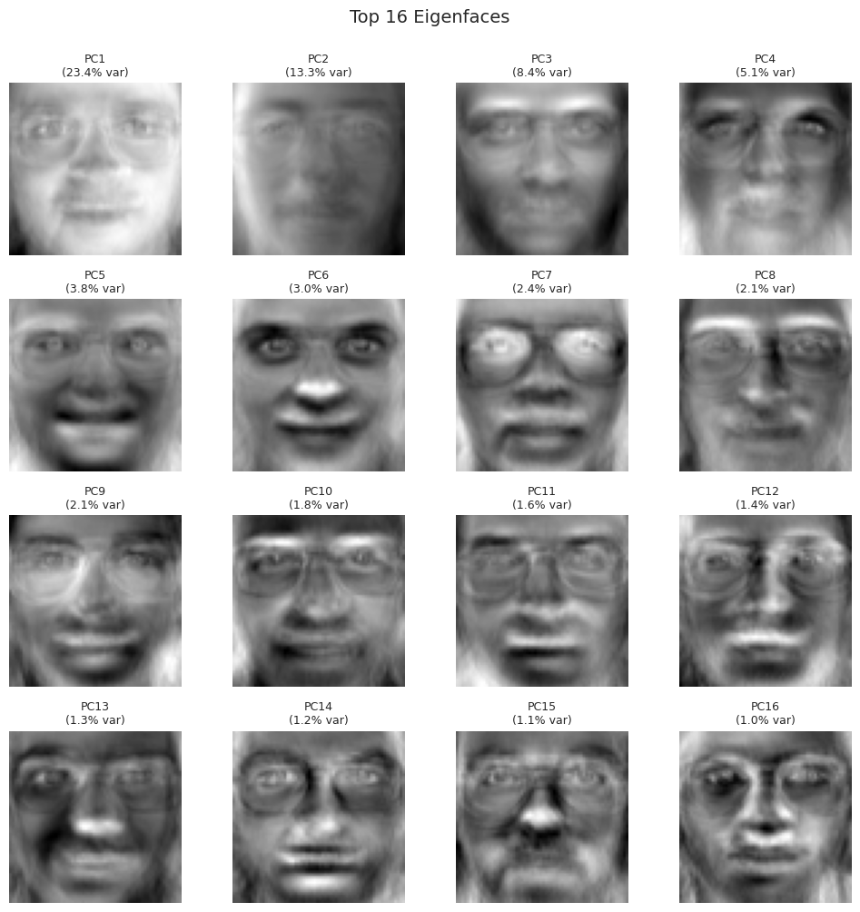
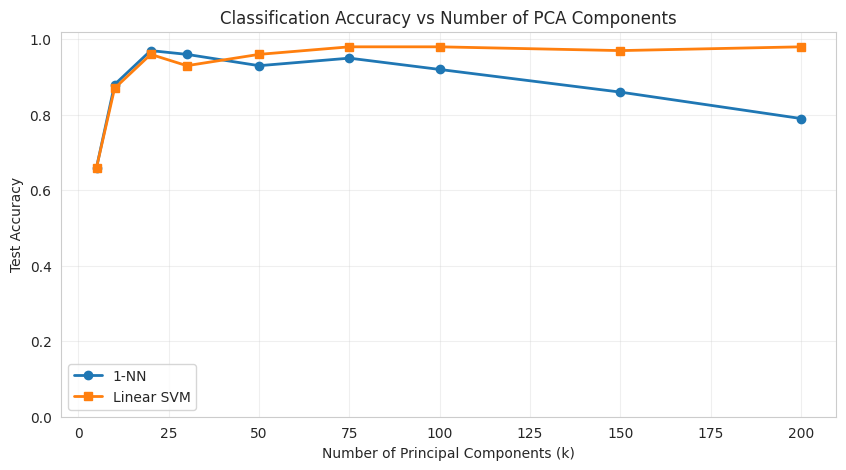
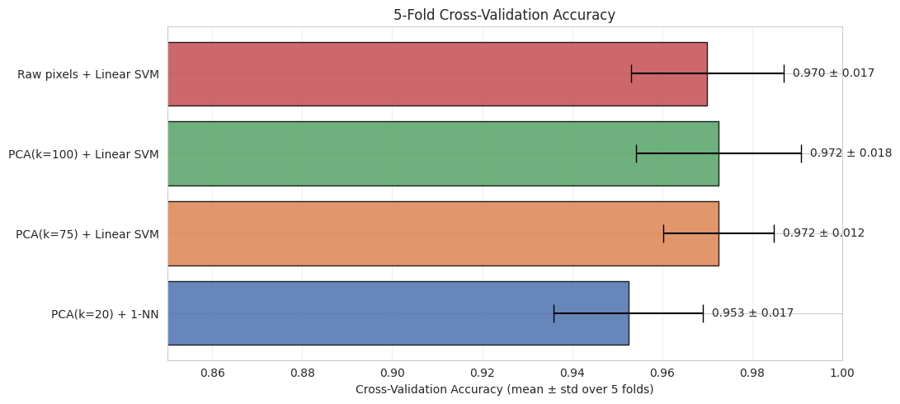
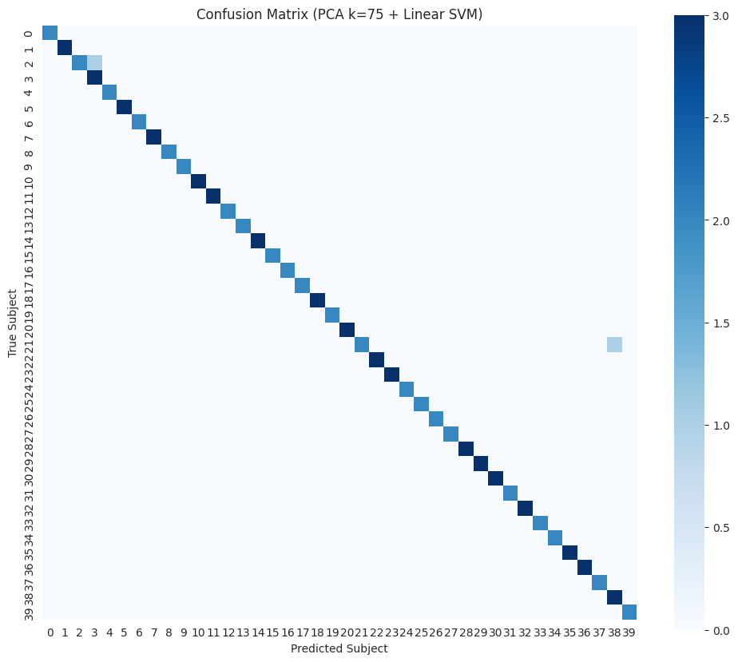
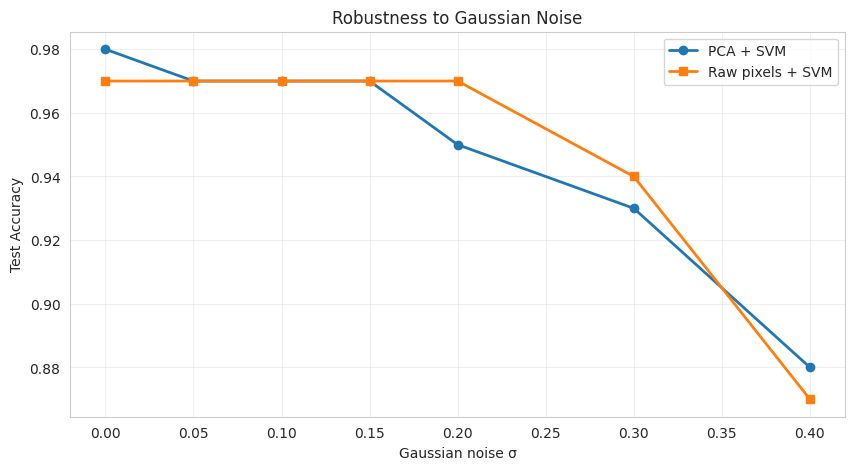
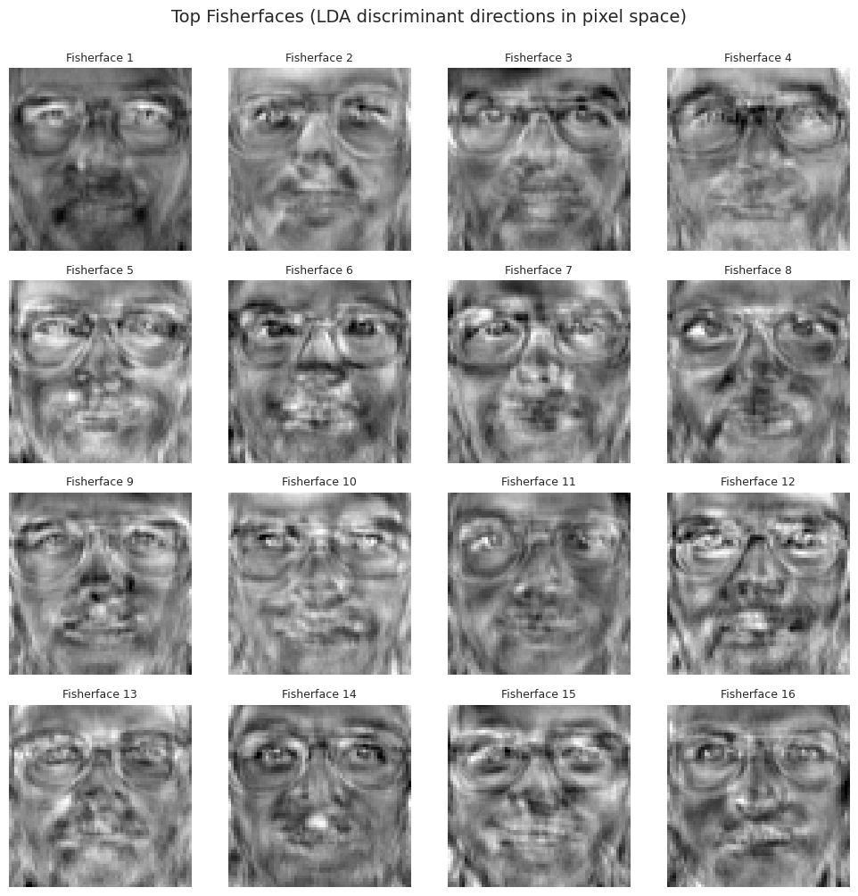

# Eigenfaces and Fisherfaces: face recognition with PCA and LDA

I built this as a classical face-recognition study on the Olivetti Faces dataset. The
notebook builds Eigenfaces from scratch, sweeps the number of principal components,
compares 1-NN against a linear SVM, tests robustness to Gaussian noise, cross-validates the
headline number, and then compares the result against Fisherfaces (PCA followed by LDA).

| Result | Value | Context |
| --- | --- | --- |
| Fisherfaces accuracy | 99.0% | 39 final dimensions (PCA 150 then LDA), single split |
| Eigenfaces accuracy | 98.0% | PCA k=75 with a linear SVM |
| Cross-validated accuracy | 97.25% +/- 1.22 | Five-fold stratified CV |



## Why PCA first

A 64x64 face is a 4,096-dimensional vector, and with 400 images the classifier is
outnumbered by the features. PCA keeps the directions that carry variance and drops the
rest, so the same classifier sees 75 dimensions instead of 4,096. That is a 54x
compression, and the question the notebook answers is what it costs.

## What the notebook does

- **Split.** Stratified 75/25 train/test split with a fixed seed.
- **Variance analysis.** Scree plot and cumulative explained variance. Most of the variance
  sits in the first 150 components.
- **Eigenfaces.** The principal components reshaped as images, plus reconstruction quality
  as a function of k.
- **Classification.** A k sweep for 1-NN and a linear SVM, then a joint GridSearchCV over
  k, C and kernel.
- **Evaluation.** Macro precision, recall and F1, a confusion matrix, and five-fold
  stratified cross-validation.
- **Baselines.** Raw pixels without PCA, to separate the effect of the classifier from the
  effect of dimensionality reduction.
- **Noise.** Zero-mean Gaussian noise at increasing standard deviation, Eigenfaces against
  Fisherfaces.
- **Fisherfaces.** PCA to 150 components, then LDA to 39.





## Results







Three numbers deserve to be kept apart:

- **98.0%** is the best single-split Eigenfaces result.
- **97.25% +/- 1.22** is the cross-validated estimate, and it is the number to quote.
- **99.0%** is Fisherfaces, which uses the labels to find the discriminative directions.
  It is the strongest result and it confirms the expected ordering: supervised reduction
  beats unsupervised reduction when the classes are known.

The GridSearchCV pass selected k=50 and C=0.1 at 96.0%, slightly below the hand-picked
k=75. That gap is a useful reminder that a single split can flatter a configuration.

## Repository layout

```text
notebooks/eigenfaces-fisherfaces.ipynb   full analysis
assets/                                  the seven figures used below
data/README.md                           dataset source
```

Commit dates reflect when the work was done. I reconstructed the history from the notebook,
the figures and the report, because the project was written in a notebook and never tracked
in git.

## Running it

The dataset downloads itself through scikit-learn on first run (about 7 MB, then cached).

```bash
pip install -r requirements.txt
jupyter notebook notebooks/eigenfaces-fisherfaces.ipynb
```

Sections run in order. The GridSearchCV section is the slow one (a few minutes on a
laptop); everything else finishes in seconds.

## Team and context

This was a course project for the Applied Machine Learning module (ESI-SBA, 2025/2026). We
were a team of four.

I owned the classification and evaluation work: the PCA component sweep, the 1-NN and
linear-SVM comparison, the confusion matrix, the raw-pixel baseline, the noise tests and
the cross-validation. The Fisherfaces implementation and its 99.0% result are a teammate's;
I include them here because they are the strongest comparison in the project.

## References

- M. Turk and A. Pentland (1991), "Eigenfaces for Recognition", Journal of Cognitive
  Neuroscience.
- P. N. Belhumeur, J. P. Hespanha and D. J. Kriegman (1997), "Eigenfaces vs. Fisherfaces:
  Recognition Using Class Specific Linear Projection", IEEE TPAMI.
- Olivetti Faces, AT&T Laboratories Cambridge, distributed through scikit-learn.

More about this project on my portfolio:
https://safouane-medjahri.vercel.app/projects/eigenfaces-fisherfaces
